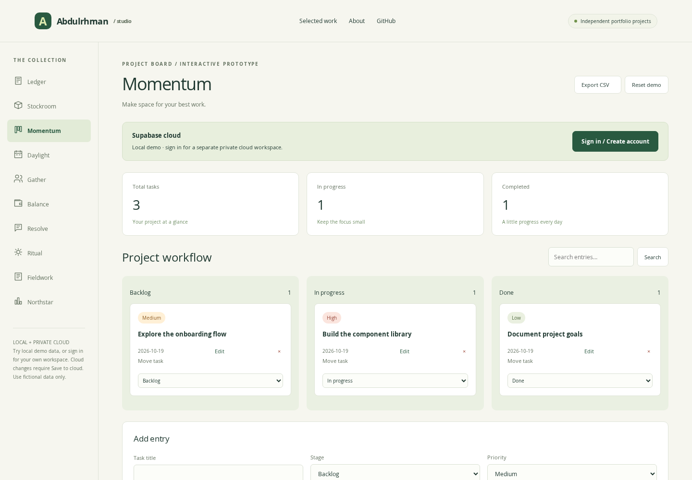

# Momentum — PROJECT BOARD

A focused project board for turning small, intentional tasks into finished work.

## Try it

From the portfolio-studio root, run `npm run serve` and open `/projects/momentum/`. No build step is needed. This entry page depends on shared `../../assets/`; deploy the entire portfolio directory.

## Implemented scope

- Kanban workflow
- Task priorities
- Due dates
- Add, edit and remove local entries, with validation.
- Guest browser-local persistence, optional private Supabase cloud snapshots and a confirmed project-only reset.

## Portfolio description

Momentum is an independent, AI-assisted frontend prototype demonstrating kanban workflow, task priorities, due dates. It uses fictional sample data and either guest browser storage or an authenticated Supabase cloud workspace, not a claim of paid client work.

## Verification and boundaries

Shared domain and browser tests are documented in [VERIFICATION](../../VERIFICATION.md). This is not a production service: Supabase authentication and owner-scoped cloud saving are available, but there is no realtime collaboration, live payment or business notification service. Email confirmation delivery still needs deployment verification. See [cloud architecture](../../backend/README.md). See the [collection README](../../README.md) for domain-specific limits.

Source implementation: [configuration](../../assets/catalog.js), [domain logic](../../assets/model.js), [interface and events](../../assets/app.js).
