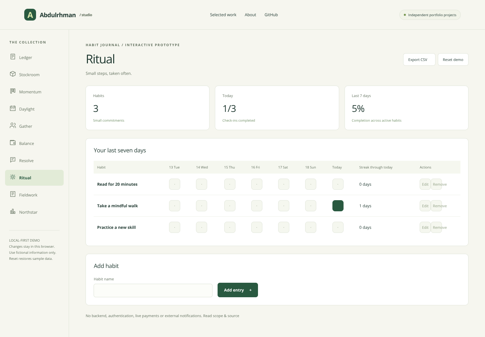

# Ritual — HABIT JOURNAL

A gentle weekly habit tracker for building a little more consistency into your day.

## Try it

From the portfolio-studio root, run `npm run serve` and open `/projects/ritual/`. No build step is needed. This entry page depends on shared `../../assets/`; deploy the entire portfolio directory.

## Implemented scope

- Seven-day check-ins
- Current streaks
- Weekly progress
- Add, edit and remove local entries, with validation.
- Browser-local persistence and a confirmed project-only demo reset.

## Portfolio description

Ritual is an independent, AI-assisted frontend prototype demonstrating seven-day check-ins, current streaks, weekly progress. It uses fictional sample data and local browser storage, not a live client backend.

## Verification and boundaries

Shared domain and browser tests are documented in [VERIFICATION](../../VERIFICATION.md). This is not a production service: there is no authentication, remote database, multi-user access, live payment or notification service. See the [collection README](../../README.md) for domain-specific limits.

Source implementation: [configuration](../../assets/catalog.js), [domain logic](../../assets/model.js), [interface and events](../../assets/app.js).
